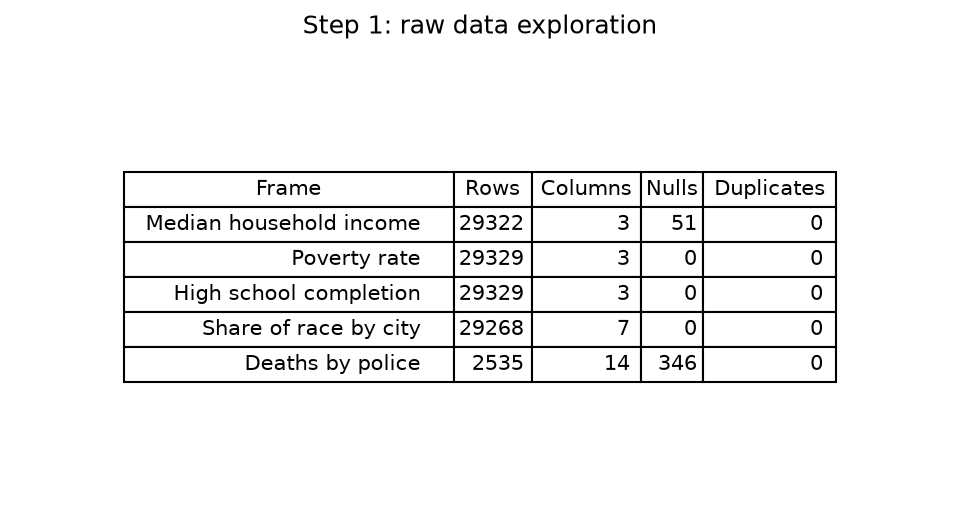
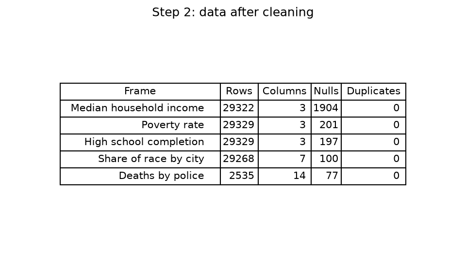
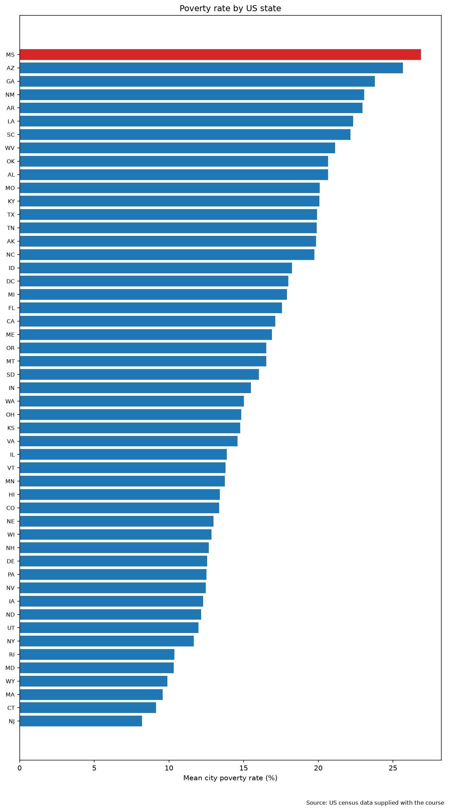
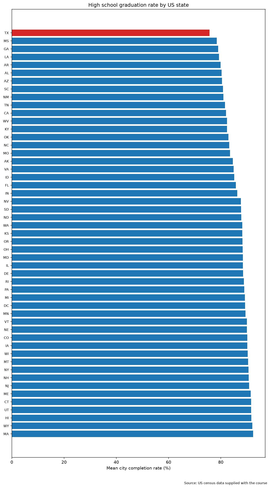
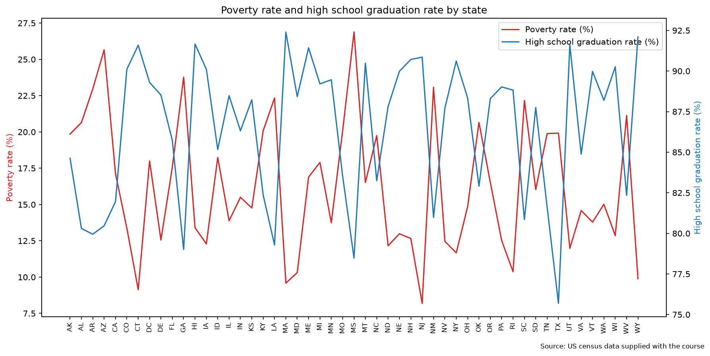
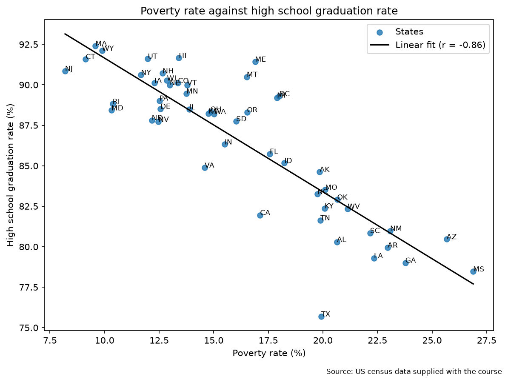
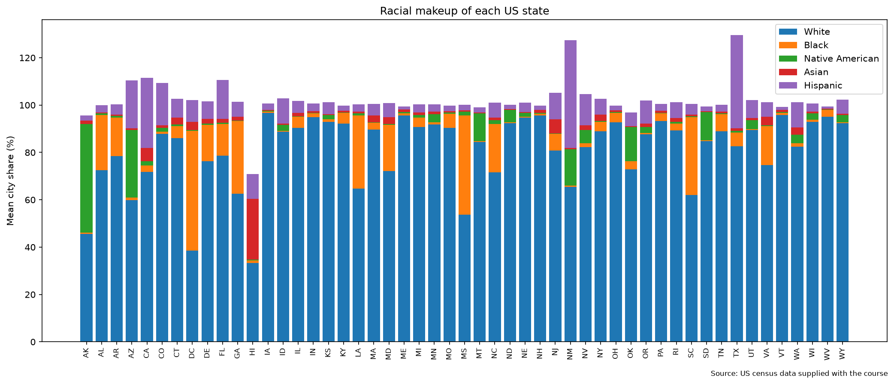
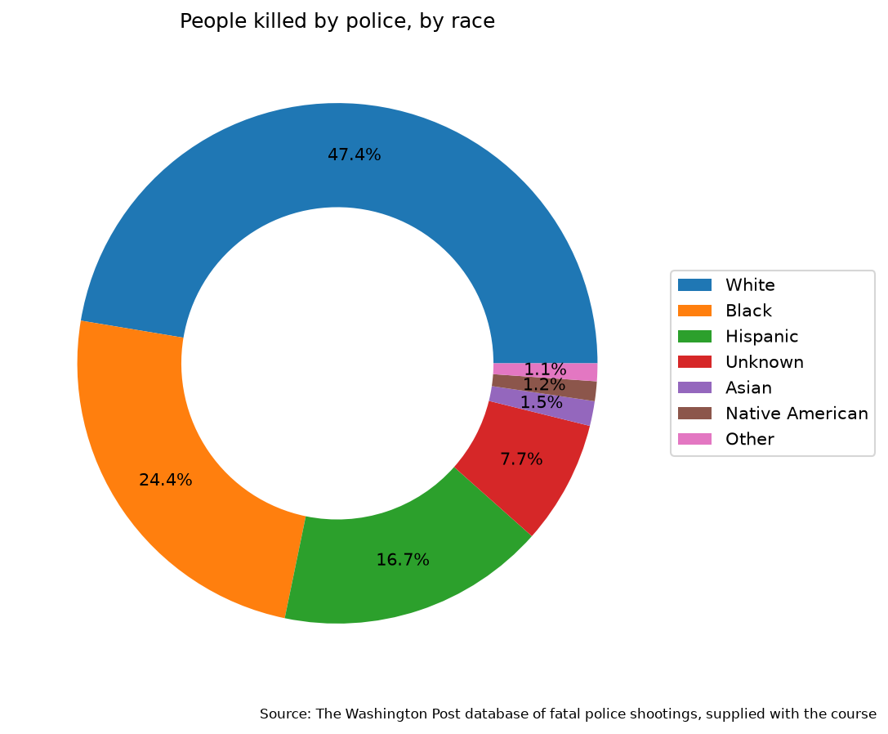

# 🚀 Fatal Force: deaths involving police in the United States

Day 100 assignment of the Udemy course "100 Days of Code: The Complete Python Pro Bootcamp": an analysis of the Washington Post database of fatal police shootings combined with US census data, for course participants who want to compare solutions and for visitors who want ideas.

## 📚 Table of Contents

- [Overview](#-overview)
- [Requirements](#-requirements)
- [Setup](#-setup)
- [Run](#-run)
- [Tests](#-tests)
- [Screenshots](#-screenshots)
- [License](#-license)
- [Links](#-links)
- [Appendix: Project documents](#-appendix-project-documents)

## 🧭 Overview

The topic is sensitive. The charts describe counts and rates and make no claim about cause. Read each chart together with its caption and the wiki page of its step.

| Folder | Purpose |
| --- | --- |
| `src/fatal_force/` | The Python package: loading, cleaning, aggregation and plotting functions, each with a Doxygen comment. |
| `src/notebooks/` | The Jupyter notebook that follows the lecture steps. |
| `tests/` | The pytest tests of the package. |
| `docs/` | Project documents, screenshots (`docs/screenshots/`) and the wiki sources (`docs/wiki/`). |

The package itself has no runtime dependencies. The notebook needs the optional `analysis` extra (polars, matplotlib, plotly, JupyterLab).

## 📋 Requirements

- Python 3.14 or later (`py -3.14 --version` on Windows, `python3.14 --version` elsewhere).
- Git.
- The course data files (see the Setup section). They are not stored in this repository.

## 🛠️ Setup

Create and use a local virtual environment named `.venv`, then upgrade pip.

Windows PowerShell:

```powershell
py -3.14 -m venv .venv
.\.venv\Scripts\Activate.ps1
python -m pip install --upgrade pip
python -m pip install -e ".[analysis,dev]"
```

Linux or macOS:

```bash
python3.14 -m venv .venv
source .venv/bin/activate
python -m pip install --upgrade pip
python -m pip install -e ".[analysis,dev]"
```

Download the course resource archive from the Day 100 lecture page, unpack it, and copy its CSV files into a `data/` folder in the repository root. The folder is ignored by git.

## ▶️ Run

Start JupyterLab from the activated environment and open the notebook:

```powershell
jupyter lab src/notebooks/fatal_force.ipynb
```

To build the Doxygen documentation of the source:

```powershell
doxygen Doxyfile
```

## 🧪 Tests

```powershell
python -m pytest
```

Before every push run the local static analysis with Opengrep:

```powershell
powershell -File scripts/opengrep.ps1
```

## 🖼️ Screenshots

One screenshot per lecture step is added as each step is finished. Each step has a wiki page in English, Danish and Bahasa Malaysia that explains what the step taught.

### Steps 1 and 2: data exploration and cleaning





### Steps 3 to 6: poverty and high school graduation









### Steps 7 and 8: racial makeup and deaths by race





## 📄 License

GNU Affero General Public License v3.0, see [LICENSE][license].

## 🔗 Links

- [Repository][repository]
- [Wiki][documentation]
- [Issue tracker][issues]

## 📎 Appendix: Project documents

| Document | What it tells you |
| --- | --- |
| [Business Case][BC-001] | Why the project exists, its scope and success criteria |
| [Stakeholder Analysis][SA-001] | Who is involved; the stakeholder IDs used for owners and reviewers |
| [Project Plan][PP-001] | The gateways and their schedule |
| [Milestones][milestones] | One document per gateway: Go/No-Go criteria and tasks |
| [Artifact registry][registry] | Where each artifact type lives, the next version, the PO language and domain |
| [Framework README][framework-readme] | The framework this project uses |
| [Framework changelog][framework-changelog] | What changed in each framework release |

---

[license]: ./LICENSE
[repository]: https://git.tirsystem.com/Tirsvad-Udemy-100-days-of-code/100-assignment-analyse-deaths-involving-police-in-the-united-states
[documentation]: https://git.tirsystem.com/Tirsvad-Udemy-100-days-of-code/100-assignment-analyse-deaths-involving-police-in-the-united-states/wiki
[issues]: https://git.tirsystem.com/Tirsvad-Udemy-100-days-of-code/100-assignment-analyse-deaths-involving-police-in-the-united-states/issues
[BC-001]: ./docs/business-case.md
[SA-001]: ./docs/stakeholder-analysis.md
[PP-001]: ./docs/project-plan.md
[milestones]: ./docs/milestones/
[registry]: ./docs/artifact-registry.md
[framework-readme]: ./framework/README.md
[framework-changelog]: ./framework/CHANGELOG.md
