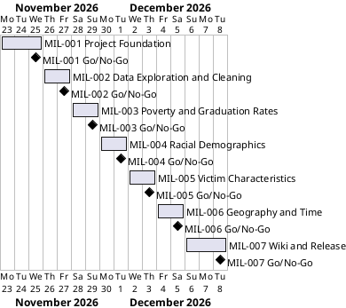

# Project Plan

## Metadata
| Key | Value |
| --- | --- |
| ID | PP-001 |
| CrossReference | [BC-001], [SA-001], [MIL-001], [MIL-002], [MIL-003], [MIL-004], [MIL-005], [MIL-006], [MIL-007] |
| Language | en |
| Domain | it |

## Version History
| Date | Status | Author | Reviewer | Change | Commit |
| --- | --- | --- | --- | --- | --- |
| 2026-11-23 | Accepted | Jens Tirsvad Nielsen | S01 (stand-in) | Accepted after review [RC-003]; autonomous mode, not independent | [7a5f122] |
| 2026-11-23 | Proposed | Jens Tirsvad Nielsen | S01 | Linked each gateway to its milestone on the git host | pending |

---

## Purpose

This plan schedules the seven gateways that deliver the Day 100 assignment against the Business Case [BC-001]. There is no external deadline, so the dates only order the work.

## Planning Assumptions

- Week 1 starts 2026-11-23; the plan ends by 2026-12-08 (source: [BC-001] Constraints, which set no deadline, so the end date is a planning choice).
- Phase length: about two days per gateway.
- One branch and one pull request per milestone, each closing its issues.
- The assignment steps are analysis steps with no interactive actor, so every task is a plain task; no use case or user story is written (decision recorded here, see Open Issues).
- The Product Owner, owner and reviewer is S01 [SA-001]; S01 is the only responsible person, so no governance RACI beyond S01 exists. Communication is in chat after each milestone (source: [SA-001] CR-001).

## Gateway Schedule

| Gateway | Document | Window | Decision date | Owner | Stories | Main deliverable | Milestone |
| --- | --- | --- | --- | --- | --- | --- | --- |
| Project Foundation | [MIL-001] | 2026-11-23 to 2026-11-25 | 2026-11-25 | S01 | none (plain analysis tasks) | Tooling, README, repository metadata | [M-001] |
| Data Exploration and Cleaning | [MIL-002] | 2026-11-26 to 2026-11-27 | 2026-11-27 | S01 | none (plain analysis tasks) | Loaders, cleaners, steps 1 and 2 | [M-002] |
| Poverty and Graduation Rates | [MIL-003] | 2026-11-28 to 2026-11-29 | 2026-11-29 | S01 | none (plain analysis tasks) | Steps 3 to 5 | [M-003] |
| Racial Demographics | [MIL-004] | 2026-11-30 to 2026-12-01 | 2026-12-01 | S01 | none (plain analysis tasks) | Steps 6 and 7 | [M-004] |
| Victim Characteristics | [MIL-005] | 2026-12-02 to 2026-12-03 | 2026-12-03 | S01 | none (plain analysis tasks) | Steps 8 to 12 | [M-005] |
| Geography and Time | [MIL-006] | 2026-12-04 to 2026-12-05 | 2026-12-05 | S01 | none (plain analysis tasks) | Steps 13 to 16 and the journal | [M-006] |
| Wiki and Release | [MIL-007] | 2026-12-06 to 2026-12-08 | 2026-12-08 | S01 | none (plain analysis tasks) | Three-language wiki, final checks, release | [M-007] |



## Scope Coverage

| Business Case scope item | Gateway |
| --- | --- |
| Data loading, exploration and cleaning | MIL-002 |
| Poverty, graduation, income and racial demographics by state | MIL-003, MIL-004 |
| Deaths by race, gender, age, armed status, mental illness, threat level, flee status | MIL-004, MIL-005 |
| Deaths by state, over time, choropleth | MIL-006 |
| Doxygen comments and `Doxyfile` | MIL-001 |
| README, screenshots, wiki in three languages, journal | MIL-001, MIL-002 to MIL-007 |
| Local static-analysis run before each push | MIL-001 and every milestone |

## Dependencies

```
MIL-001 → MIL-002 → MIL-003 → MIL-004 → MIL-005 → MIL-006 → MIL-007
```

A No-Go on a gateway stops the chain and moves every later decision date, and the end date 2026-12-08, by the rework time. S01 decides the new end date.

## Plan Risks

| Risk | Impact | Mitigation |
| --- | --- | --- |
| The course data link has expired (from [BC-001] Risks) | MIL-002 cannot start | Stop and report; S01 supplies the archive |
| Python 3.14 is missing in a fresh environment | Tests cannot run as required | The README states `py -3.14`; MIL-001 task 1 checks the version |
| Screenshots are costly to keep current (from [BC-001] Risks) | Documentation drifts | One script writes all figures to `docs/screenshots/` |
| Three-language wiki doubles the writing | MIL-007 slips | Each milestone writes its own pages, so MIL-007 only assembles and checks |

## Open Issues

- The repository named in the request (`Tirsvad-Udemy-100_days_of_code`) differs from the `origin` remote (`Tirsvad-Udemy-100-days-of-code`); the plan follows `origin`.
- Whether the course data may be redistributed is unknown; the plan keeps it out of git (ADR in MIL-001).
- No use cases are written because the tasks are plain analysis steps; S01 can ask for them.
- Python 3.14 is available as `py -3.14`, while the default `python` is 3.13.
- The Doxygen executable and Opengrep path are assumed present; the first milestone checks both.

---

[BC-001]: ./business-case.md
[SA-001]: ./stakeholder-analysis.md
[MIL-001]: ./milestones/milestones\mil-001-foundation.md
[MIL-002]: ./milestones/milestones\mil-002-data-exploration-cleaning.md
[MIL-003]: ./milestones/milestones\mil-003-poverty-graduation.md
[MIL-004]: ./milestones/milestones\mil-004-racial-demographics.md
[MIL-005]: ./milestones/milestones\mil-005-victim-characteristics.md
[MIL-006]: ./milestones/milestones\mil-006-geography-and-time.md
[MIL-007]: ./milestones/milestones\mil-007-wiki-and-release.md
[RC-003]: ./sqa/reviews/rc-003-project-plan.md
[7a5f122]: https://git.tirsystem.com/Tirsvad-Udemy-100-days-of-code/100-assignment-analyse-deaths-involving-police-in-the-united-states/commit/7a5f122ced31642b5b69abdb4cf3a98e4941268f
[M-001]: https://git.tirsystem.com/Tirsvad-Udemy-100-days-of-code/100-assignment-analyse-deaths-involving-police-in-the-united-states/milestone/722
[M-002]: https://git.tirsystem.com/Tirsvad-Udemy-100-days-of-code/100-assignment-analyse-deaths-involving-police-in-the-united-states/milestone/723
[M-003]: https://git.tirsystem.com/Tirsvad-Udemy-100-days-of-code/100-assignment-analyse-deaths-involving-police-in-the-united-states/milestone/724
[M-004]: https://git.tirsystem.com/Tirsvad-Udemy-100-days-of-code/100-assignment-analyse-deaths-involving-police-in-the-united-states/milestone/725
[M-005]: https://git.tirsystem.com/Tirsvad-Udemy-100-days-of-code/100-assignment-analyse-deaths-involving-police-in-the-united-states/milestone/726
[M-006]: https://git.tirsystem.com/Tirsvad-Udemy-100-days-of-code/100-assignment-analyse-deaths-involving-police-in-the-united-states/milestone/727
[M-007]: https://git.tirsystem.com/Tirsvad-Udemy-100-days-of-code/100-assignment-analyse-deaths-involving-police-in-the-united-states/milestone/728
